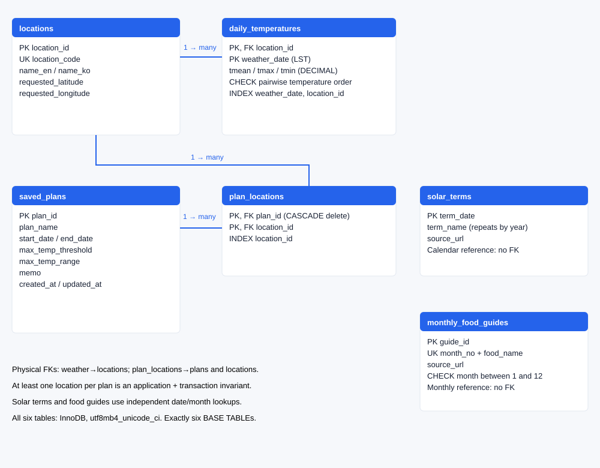
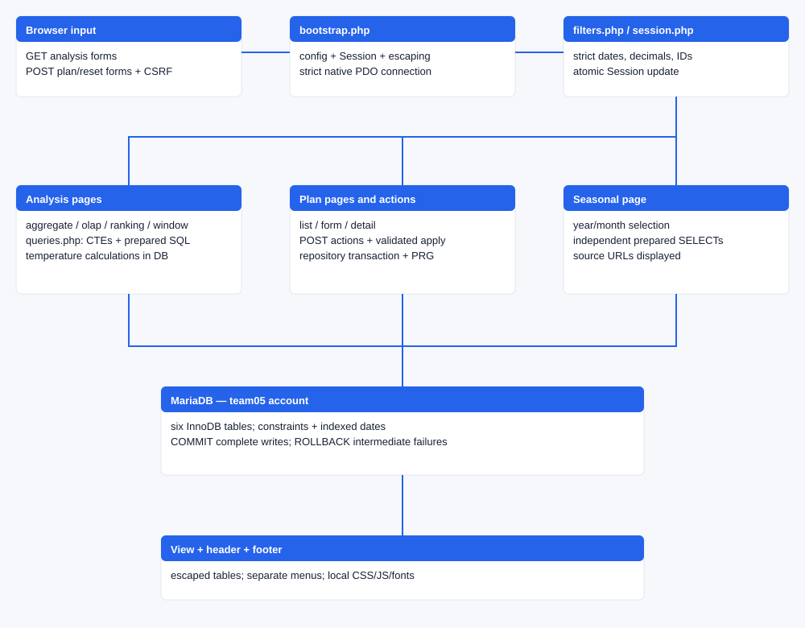

# Seasonal Living Guide — Implementation Report

**Team 05 · Weather Data Analysis · Evidence-based draft · 2026-11-12, Asia/Seoul**

This draft describes the implemented system and observed test results. It is ready for technical review, with individual human contribution statements and final course submission still pending. Page counts refer to rendered draft PDFs only. The local source specification is preserved separately and was not uploaded as the project README.

## 1. Purpose, users and completed scope

Seasonal Living Guide compares historical temperatures at five requested points in Korea: Seoul, Busan, Daegu, Gwangju and Jeju. A user chooses dates, locations, a maximum daily temperature and a maximum daily range. Four separate analysis menus answer different questions: grouped summaries compare periods, hierarchical exploration reveals daily details, dense ranking compares the proportion of qualifying days, and moving averages show continuous temperature patterns.

The application is an actual Apache/PHP/MariaDB system. Data is loaded from supplied SQL before browsing; no API or CDN is required at runtime. Permanent comparison plans are stored in MariaDB. Current comparison conditions are kept in a PHP session and can be applied across analysis pages. Calendar dates and monthly ingredients form a separate reference feature.

| Member ID | Member supplied in the specification |
|---|---|
| 2371001 | Nunnalin Heimvichit |
| 2376329 | Jieun Hwang / 황지은 |
| 2376274 | Sumin Cho / 조수민 |
| 2476009 | Koo Daon / 구다온 |
| 2276337 | Jihee Choi / 최지희 |

The confirmed assignment gives each member 20% responsibility for technical work, the report, the English paper and presentation. Nunnalin owns data/schema/four SQL files (slides 2–3); Jieun owns common PHP/PDO/Session/UI and seasonal references (4–5); Sumin owns plans/transactions (6–7); Koo Daon owns grouping/OLAP (8–9); Jihee owns ranking/windows/charts (10–11). Slides 1 and 12 are shared. Integration, English editing, PPT/video and final checks are shared equally. Actual human review remains NOT_RUN for each person. One sequential Codex session implemented these revisions; assignment does not rewrite Git authorship. [team-responsibilities.md](team-responsibilities.md) is the detailed responsibility record.

The comparison is deliberately bounded. NASA values are historical gridded reanalysis, rather than urban station observations or forecasts. A high matching rate means a larger share of historical valid days met the chosen limits. It does not establish safety, health benefit, or overall comfort. Ingredient entries are historical monthly editorial selections, independent of weather and location-specific harvest timing. There is no login, map, real-time forecast, nutrition database or AI recommendation subsystem.

A representative workflow is to compare August 2024 across all five locations, inspect the tied ranking, open a particular month in the explorer, save the comparison conditions, update the selected locations and apply that plan to another analysis. The implementation and tests cover this complete workflow.

## 2. Actual development sequence and traceability

The work began with README.md as the only project file and no Git repository. All 1,157 specification lines were read. No applicable AGENTS.md existed in the project or ancestor directories. The specified remote returned no references, so no remote commits were overwritten. The existing configured Git identity was retained. Initial shell sandbox startup failed before executing commands; approved project command execution was used afterward.

Host PHP, Apache and MariaDB executables were not found in PATH or the checked common XAMPP locations. Docker 29.6.2 was available. Dedicated project containers were therefore created without altering host packages, existing containers, databases or server-wide SQL settings.

| Milestone | Actual implementation and evidence | Recorded commit |
|---|---|---|
| P0 | Inspect files, remote and environment | bfec3f7 |
| P1 | Schema and strict input contracts; local runtime | e660795 |
| P2 | Download and validate real NASA data; deterministic seed | c9ff724 |
| P3 | Actual schema creation and constraint probes | 376d5a8 |
| P4 | Nine Apache routes, common views and Session | 4198842 |
| P5a | Complex grouping versus independent raw oracle | d7b7b15 |
| P5b | Hierarchy queries and WITH ROLLUP | 932d1d0 |
| P5c | Dense ranks, ties and denominator tests | 71340b0 |
| P5d | Continuous 7/30-day frames and boundaries | 0e7e894 |
| P6 | Web CRUD and two real FK-failure rollbacks | fba9c9f |
| P7 | Calendar and monthly food queries | 3dcb986 |
| P8 | Browser, clean install, dump and offline execution | cb2ce62; subsequent compatibility evidence in history |

Each milestone was checked before its commit. The original milestones initially encountered missing HTTPS credentials. The user subsequently authenticated and pushed all original commits and the existing review tag. Revision commits have been pushed successfully; observed local/remote SHAs are retained in revision evidence. The original failure remains a historical event. No force push, reset-hard, fabricated authors or parallel development branches were used. [progress.md](progress.md) records commands, changes, observed failures and corrections. [requirements.md](requirements.md) maps all 30 requirements to implementation paths and evidence; [test-results.md](test-results.md) distinguishes PASS from NOT_RUN.

### Revision execution and verified responsibility results

| Revision stage | Concrete result and evidence |
|---|---|
| A–B | Preserved pre-revision DB, commits and review tag; fixed evidence interpretation with normal/failure/missing fixtures |
| C | Timestamp/rollback, memo zero, current-input saving and UTF-8 fixes verified through SQL and HTTP |
| D | Original blue/white UI and SQL-value chart; all nine screens and edit verified at four viewport sizes |
| E–F | Equal 20% responsibility matrix, honest human status and reproducible current-source listings |
| G–I | Full runtime/fresh-install checks, committed-source media and rendered drafts; concrete package verification retained separately |

| Assigned responsible member | Actual automated implementation result | Actual personal confirmation |
|---|---|---|
| Nunnalin Heimvichit (2371001) | Data validation, schema probes, deterministic UTF-8 seed and fresh SQL restoration passed | NOT_RUN |
| Jieun Hwang (2376329) | Common filter/Session, current-input save, nine-screen UI and seasonal tests passed | NOT_RUN |
| Sumin Cho (2376274) | Real web CRUD, timestamp ordering, memo zero and FK rollback tests passed | NOT_RUN |
| Koo Daon (2476009) | Independent weighted grouping and hierarchical/ROLLUP SQL checks passed | NOT_RUN |
| Jihee Choi (2276337) | Unrounded tied ranks, continuous window and direct-SQL chart checks passed | NOT_RUN |

Assignment is responsibility, not a claim that a student personally ran the automated checks. The agreed total oral time is unspecified; when T is agreed each receives about T/5. No official duration is invented.

## 3. Sources, coordinates and data preparation

Each temperature row represents one requested location on one NASA Local Solar Time (LST) date. The period is 2023-01-01 through 2025-12-31 inclusive: 365 + 366 + 365 = 1,096 days per location and 5,480 location-day rows. Requested coordinates are preserved as such; they are not labeled as the provider's grid-center coordinates.

| ID | Location | Requested latitude | Requested longitude | Daily rows |
|---|---|---:|---:|---:|
| 1 | Seoul | 37.5665 | 126.9780 | 1096 |
| 2 | Busan | 35.1796 | 129.0756 | 1096 |
| 3 | Daegu | 35.8714 | 128.6014 | 1096 |
| 4 | Gwangju | 35.1595 | 126.8526 | 1096 |
| 5 | Jeju | 33.4996 | 126.5312 | 1096 |

`tools/fetch_data.py` downloaded the five exact NASA requests sequentially, preserving response bytes, URL, collection timestamp and SHA-256. `tools/validate_data.py` locates the `-END HEADER-` marker and parses named CSV columns rather than deleting a fixed number of header lines. It checks date sets, duplicate keys, real dates, numeric values, missing sentinels and the three pairwise temperature-order comparisons. Every location includes 2024-02-29; all duplicate, missing, out-of-range, missing-temperature and order-error counts are zero.

The newly acquired bytes match all five supplied reference hashes exactly. `T2M`, `T2M_MAX` and `T2M_MIN` become `tmean`, `tmax` and `tmin`. No interpolation, invented measurements or synthetic weather rows are used in the delivered seed. Full source metadata and checks are in [manifest.json](../data/manifest.json) and [data-validation.md](data-validation.md).

KASI's 72 date/name occurrences and RDA's 12 month/ingredient items were transcribed from the user-supplied reference appendices. This session did not newly download or independently reverify those pages. RDA publication dates and original source URLs are retained in the curated snapshot. KASI is labeled calendar reference material; comparison with the final official almanac remains unperformed.

Only validated inputs produce `dbinsert.sql`. Repeated generation yielded the same hash. The seed contains 5 locations + 5,480 temperatures + 72 terms + 12 food guides = 5,569 rows, with empty saved-plan tables. Python is a development-only preparation and independent-oracle tool; the installed PHP application does not invoke it.

## 4. Six-table schema, constraints and normalization



| Table | Grain and primary key | Important constraints / indexes |
|---|---|---|
| locations | One requested point; location_id | Unique code; requested decimal coordinates |
| daily_temperatures | One location and LST date; composite PK | Location FK, date/location index, nullable DECIMAL temperatures and pairwise ordering CHECK |
| solar_terms | One actual occurrence date; term_date | Repeated names across years are permitted; source URL required |
| monthly_food_guides | One monthly editorial item; guide_id | Unique month/name; month 1–12 CHECK |
| saved_plans | One saved comparison; plan_id | Ordered dates CHECK, nonnegative range CHECK, updated/id index |
| plan_locations | One selected region in a plan; composite PK | Plan FK with cascading delete, location FK, location index |

All six physical tables use InnoDB, utf8mb4 and utf8mb4_unicode_ci. Weather units are degrees Celsius, stored as DECIMAL rather than binary floating point. Year, month, daily range, averages and ranks are derived in SQL and are not redundantly stored. The association table represents the many-to-many relationship between plans and locations without comma-separated ID fields.

Physical foreign keys exist only where shown by connecting lines. Solar terms and food guides are independent date/month references. They are not artificial parents of daily weather. At least one selected location per plan is an application and transaction invariant; a foreign key alone cannot enforce that minimum cardinality.

Schema verification executed actual duplicate-key, invalid-location, invalid-month, reversed-plan-date and inverted-temperature probes. The temperature test also used a NULL mean with reversed minimum/maximum to ensure that the third pairwise CHECK is effective. All probes failed as intended and were rolled back. Metadata and exact row counts are preserved in [schema.json](evidence/revision-2026-11-12/schema.json).

## 5. PHP structure, common filters and Session



The bootstrap loads central configuration, starts a strict PHP session before output, connects through PDO and sets the database session's SQL mode to include ONLY_FULL_GROUP_BY. PDO uses exceptions, associative results and native prepared statements (`ATTR_EMULATE_PREPARES=false`). The connection charset is utf8mb4. The database connection time zone is explicitly +09:00 to match displayed plan timestamps; weather date semantics remain NASA LST.

| Common input | Validation | Default |
|---|---|---|
| location_ids | Array of strict IDs 1–5; deduplicated/sorted; at least one | All five |
| start_date / end_date | Real YYYY-MM-DD, within data period, ordered | 2025-01-01 / 2025-12-31 |
| max_temp_threshold | Finite decimal, −50 to 60, ≤2 decimals | 28.00 |
| max_temp_range | Finite decimal, 0 to 60, ≤2 decimals | 10.00 |

The filter form includes an explicit submission marker. Empty location selection is an error, not a request to silently restore previous locations. A new valid request has priority over stored Session conditions; otherwise Session values apply, with defaults only when neither exists. Common and page-specific options must both validate before Session changes. Tests confirm an invalid request preserves the previous Session and returns HTTP422 without running an analysis.

Separate option whitelists control grouping, hierarchy level, year/month, minimum valid days, Top N rank, metric and window focus. Value placeholders never stand in for identifiers or SQL expressions. The number of region placeholders equals the number of selected IDs. The code uses positional placeholders consistently and binds integer options as PDO::PARAM_INT.

Analysis reset is a CSRF-protected POST that resets only analysis conditions/options, preserving the CSRF token. Plan application first reads database conditions and location IDs, validates them through the same common parser, then writes Session conditions. Page-specific presentation settings remain outside the saved-plan contract.

## 6. Complex grouping: Temperature Comparison

`aggregate.php` groups by location × year × month, or by location × year. The base CTE classifies every candidate daily row using three flags. A valid day has all three temperature values. A matching day is valid and satisfies both inclusive limits. An exceedance day is valid and its maximum exceeds the selected maximum limit.

```sql
SUM(valid_flag) AS valid_days,
AVG(CASE WHEN valid_flag=1 THEN tmean END) AS mean_temperature,
AVG(CASE WHEN valid_flag=1 THEN tmax-tmin END) AS mean_daily_range,
SUM(exceedance_flag) AS exceedance_days,
SUM(matching_flag) AS matching_days,
100.0*SUM(matching_flag)/NULLIF(SUM(valid_flag),0) AS matching_rate
```

The actual query also returns mean daily maxima/minima and period extreme high/low. The threshold is used for classification, never to remove candidate weather rows before aggregation. Consequently changing a limit changes matching/exceedance counts while preserving the valid-day denominator. A year row covering selected months is labeled as a partial-period summary.

Independent expected results come from `tests/oracle.py`, which parses original CSV bytes separately and computes Decimal statistics without importing the application's query builder or data parser. Ten January/February 2024 groups and five combined partial-year groups were compared with the database. Every returned statistic agreed within 0.00001°C/count tolerance; counts were checked exactly where relevant.

| Seoul period / fixture | Observed result |
|---|---|
| January 2024 | 31 valid days; mean −1.781290°C; average daily range 7.586452°C |
| Jan–Feb 2024 | 60 valid days; weighted daily mean 0.018667°C |
| Boundary: maximum=28, range=10 | Matching day |
| Maximum=28.01 or range=10.01 | Nonmatching day |
| Four-row boundary/NULL fixture | 4 candidates; 3 valid; 1 match; 1 exceedance |

Averages use the same valid-day set. The mean daily range is the average of daily differences, not the monthly maximum minus monthly minimum. The Jan–Feb result derives from 60 daily observations rather than averaging two monthly means with equal weights.

## 7. OLAP: Temperature Explorer

`olap.php` changes the actual SQL grouping dimensions for year, month and day views. Distinct drill links lead from a year to that year's months, then to a month's daily records. Breadcrumb links return to month or year views. Drill bounds intersect the common comparison period; the system never broadens dates to accommodate a drill. An empty intersection is explicitly explained.

The roll-up panel uses MariaDB's physical `WITH ROLLUP` syntax. It computes monthly groups, annual subtotals, location subtotals and a grand total from raw daily records. Grouping occurs inside a CTE and ordering outside it, avoiding the MariaDB restriction on combining WITH ROLLUP and ORDER BY in the same SELECT.

```sql
SELECT location_id, year_no, month_no,
       SUM(valid_flag) valid_days,
       AVG(CASE WHEN valid_flag=1 THEN tmean END) mean_temperature
FROM base
GROUP BY location_id, year_no, month_no WITH ROLLUP
```

The application distinguishes subtotal NULL dimensions from missing weather values. It displays “Annual subtotal,” “Location subtotal” and “All selected locations.” Totals across multiple locations count location-days, not distinct calendar days. Two locations on the same date contribute two daily records.

| Actual January–February 2024 drill check | Observed |
|---|---:|
| Location × year groups | 5 |
| Location × month groups | 10 |
| January daily location-day records | 155 |
| Jan15–Jan31 intersection for Seoul | 17 |
| Grand total across five locations and two months | 300 location-days |

Upward return recomputed the same results as the original year query. Annual/location means matched independent raw-day values. An out-of-period drill returned no rows. HTTP and Chromium tests followed year→month→day→month→year, confirming actual links and executable page behavior rather than only direct SQL calls.

## 8. Ranking: Find My Season

`ranking.php` first counts valid and matching days per selected region. It excludes zero-valid and insufficient-valid-day regions, computes a high-precision DECIMAL rate, and then assigns `DENSE_RANK()` ordered only by the unrounded rate. A final outer predicate selects ranks ≤ Top N. Location ID is used only for deterministic presentation, not to break window-function ties.

```sql
SELECT r.*,
       DENSE_RANK() OVER (ORDER BY matching_rate DESC) AS rank_no
FROM rates r
```

Top N therefore means N ranks including every tie. It does not mean LIMIT N rows. A fixture where one region had 2 matches out of 4 valid days and another 3 out of 6 returned the same rank. A separate fixture with 1/1095 versus 1/1096 produced different ranks although both displayed percentages rounded to the same two decimal places. These tests verify the division and ordering logic independently of a convenient example.

For 2024-08-01 through 2024-08-31, maximum ≤28°C and daily range ≤10°C, all five locations, minimum valid days 1:

| Rank | Location | Matching / valid | Displayed rate |
|---:|---|---:|---:|
| 1 | Busan | 2 / 31 | 6.45% |
| 1 | Daegu | 2 / 31 | 6.45% |
| 2 | Jeju | 1 / 31 | 3.23% |
| 3 | Seoul | 0 / 31 | 0.00% |
| 3 | Gwangju | 0 / 31 | 0.00% |

The result agrees with the independent Decimal oracle and the supplied same-hash source version. Selecting Top1 in both HTTP and Chromium returned Busan and Daegu together. The page exposes matching days and valid days so that users can judge the denominator, including cases with limited coverage. The values are computed by MariaDB, not emitted from the report's table as constants.

## 9. Windowing: Temperature Trends

`window.php` supports mean, maximum, minimum and daily-range metrics. Both 7-day and 30-day averages are calculated in MariaDB; the selected option controls which output column is emphasized. Each window includes the current date and the preceding 6 or 29 daily records, partitioned only by location. Year and month are not partition keys.

```sql
AVG(metric_value) OVER (
  PARTITION BY location_id ORDER BY weather_date
  ROWS BETWEEN 6 PRECEDING AND CURRENT ROW
)
```

The internal scan starts up to 29 days before the displayed start date. SQL calculates the averages over this continuous history; only the outer SELECT filters the displayed dates. Matching thresholds do not filter the internal series. The metric value is NULL for an invalid day; the same frame counts valid metric values. A displayed moving average requires count 7 or 30 and the expected date span, so a gap cannot masquerade as a calendar-day window.

| Input / independent expectation | Actual MariaDB output |
|---|---|
| Synthetic sequence 1..35, day7 | 7-day mean 4.000000 |
| Same sequence, day30 | 30-day mean 15.500000 |
| Display only from day31 | 7-day 28.000000; 30-day 16.500000 |
| Seoul 2024-01-01 | 7-day 1.141429; 30-day 0.301333 |
| First 6 / first 29 source days | Corresponding average NULL |
| A missing date or NULL-value day in frame | Incomplete average remains NULL |
| Same series with a second location +100 | Separate location averages differ by exactly 100 |

Forty independent raw-CSV expectations cover five locations, two dates, four metrics and both frames. The dates include the year boundary and 2024-03-01 after leap February. A display-start change preserves the same date's average. SQL-derived valid display-day counts are shown with each location, and the result table identifies both frame counts. The interface distinguishes “Insufficient history” from a valid numeric zero.

The original SVG chart plots the returned SQL daily/7-day/30-day values directly. A graph-only selector chooses one location from the global comparison without changing that global set. Date coordinates use elapsed calendar days; absent dates and NULL values break lines. One-day results use finite points. Both focus options emphasize the same SQL series in graph and table. The table remains available without JavaScript. All 5,480 daily rows can be displayed in a scrollable table; PHP performs no new moving-average calculation. The boundary checks are retained in [window-tests.json](evidence/revision-2026-11-12/window-tests.json).

## 10. Persistent plans, transactions and real rollback evidence

A plan saves its title, dates, two temperature limits, memo and selected locations. It does not promise to save grouping, Top N display or window focus. `plans.php` and `plan_detail.php` read persistent data from MariaDB. The form supports Unicode titles of 1–100 characters and memos of up to 2,000 characters; lengths are character counts rather than byte counts.

`plan_actions.php` accepts only POST, validates a Session-bound CSRF token, normalizes input and invokes the repository transaction. Successful writes redirect with HTTP303, implementing Post/Redirect/Get. The detail view can apply the stored common filters to a selected, whitelisted analysis page. This action revalidates values read from the database before changing Session state.

```text
CREATE: begin → insert parent → lastInsertId → insert each region → commit
UPDATE: begin → lock/check parent → update body → delete old links
        → insert replacement links → commit
ANY FAILURE: if transaction active → rollback → propagate failure
DELETE: begin → lock/check parent → delete parent → FK cascade → commit
```

The update path checks existence separately and accepts a same-value update even when the affected-row count is zero. Every accepted update explicitly sets updated_at=CURRENT_TIMESTAMP, including location-only changes. A real FK failure restores the exact timestamp as well as body and children. Memo fallback tests distinguish the literal string "0" from an empty memo. Parent and link changes are never committed in separate stages. Deletion requires POST/CSRF, cascades links and preserves unrelated plans.

The rollback tests deliberately bypass only the web validation layer at the internal repository boundary. A CLI fixture supplies valid parent fields and child IDs `[1,99]` or `[2,99]`, so an actual FK failure occurs after earlier SQL statements succeed. There is no failure-injection query parameter, admin menu or test route in the delivered web code.

| Real database test | Observed evidence |
|---|---|
| Create commit then read | Exact body and selected regions persisted |
| Update and identical update | Body/regions replaced; same-value save accepted |
| Delete one of two plans | Target parent/links removed; other parent preserved |
| Parent INSERT, first child, failing child | SQLSTATE23000 on fk_plan_location; auto-increment advanced; residual parent=0, links=0 |
| Body UPDATE, old-child DELETE, failing new child | Exact original parent and location snapshot restored |

The FK exceptions, counts and before/after snapshots are in [plans-tests.json](evidence/revision-2026-11-12/plans-tests.json). Web CRUD, applying a plan, validation errors and deletion were also executed through real HTTP and Chromium. All temporary plans were removed. Auto-increment gaps created by rollback are normal database behavior and do not imply surviving partial plans.

## 11. Interface, controls and request protection

Nine user-facing screens exist: Home; Temperature Comparison; Temperature Explorer; Find My Season; Temperature Trends; Seasonal Information; Saved Plans; Create/Edit Plan; Plan Details. The POST handler is not counted as a user page. Every page uses the same navigation with four distinct analysis entries.

The revised original interface uses #F6F8FB page backgrounds, white cards, #172033 text, #475569 secondary text, #2563EB controls and a bundled Korean font under the SIL Open Font License. The sun/cloud SVG is shared by header, footer and favicon. Controls are at least 44px high; standard labels are at least 13px. Compact filter panels place the first comparison result row inside both tested desktop heights. The default comparison has seven columns; all remaining SQL metrics are available in More statistics. It uses only local CSS, JavaScript and fonts. Analysis output is a table with clear units, dates, limits and valid counts. Wide result tables scroll within their containers. Buttons and labels are keyboard accessible; the document includes a skip link and visible focus states. Core forms work without JavaScript; JavaScript adds deletion confirmation only.

| Control / behavior | Actual verification |
|---|---|
| Date, numeric, checkbox, select and buttons | Dynamic forms exercised in Chromium and HTTP |
| Session persistence | Aggregate filter reused on ranking; plan applied on window then ranking |
| Invalid inputs | Empty regions, unknown IDs, reversed/fake dates, NaN/INF, decimal precision and unknown options rejected |
| HTML output | Script/name/memo escaped with ENT_QUOTES and UTF-8 substitution |
| SQL input | SQL metacharacter title stored literally; five location rows and 5,480 weather rows preserved |
| Change protection | GET handler405; invalid CSRF403; invalid shapes422 |
| Direct PHP helper/config requests | Apache403 under the tested development runtime |
| Responsive layout | All nine screens plus valid edit at 1440×900, 1366×768, 390×844 and 360×844; no document overflow |

The Session cookie is HttpOnly with SameSite=Lax and strict mode. Responses use a self-origin Content Security Policy and nosniff. Redirect targets are fixed analysis names, preventing arbitrary redirect URLs. Browser-visible error pages do not expose passwords, complete DSNs or raw SQL exception details. Detailed server exceptions go to the project server log, whose examined PHP warning/fatal/parse/notice count was zero after functional tests.

Saved Plans is explicitly a shared demonstration space. This version has no authentication or per-person ownership isolation and does not describe those records as private. These bounded protections were tested; they are not presented as a comprehensive security certification or a production hosting design.

## 12. Seasonal reference feature and independence of analyses

`seasonal.php` validates a selected year in 2023–2025 and a month in 1–12. Solar terms are queried between the first date of that month and the first date of the next month. Food guides use a separate `WHERE month_no=?` query. Every displayed item includes an original source link.

```sql
SELECT term_date,term_name,source_url
FROM solar_terms WHERE term_date>=? AND term_date<? ORDER BY term_date;
SELECT month_no,food_name,source_url
FROM monthly_food_guides WHERE month_no=? ORDER BY guide_id;
```

The distinction is intentional. Joining several food items to each daily temperature and then aggregating could multiply location-day records. This implementation never performs that join. T28 inserts an extra August guide item inside a transaction and compares aggregate, ranking and window results before and after. All weather outputs remain exactly identical while the monthly guide query correctly returns two items. The fixture is rolled back afterward.

All 36 year-month selections were exercised via Apache HTTP, each returning term and food references. CLI checks confirm 24 solar terms per year, 72 occurrences overall and at least one guide for every month. The year-specific dates are retained: the first February term is 2024-02-04 in 2024 and 2025-02-03 in 2025. Dates are not copied as fixed annual month/day values.

The source limitation is visible in the product and report. KASI entries are calendar references, not a claimed final-almanac cross-check. Exact solar transition times are outside the feature. NASA LST daily values are not equated to a KST transition instant. RDA items come from historical “ingredient of the month” editorial features; they do not measure food availability in a selected 2023–2025 month or establish local harvest timing.

No health claims, recipes, prices, nutrition details or copied food images are included. No live source availability is necessary for browsing the guide. The source links are for optional human consultation; reference rows are already installed through SQL. This preserves the requested seasonal context without changing the meaning or denominator of the temperature analyses.

## 13. Installation, four SQL files and executed verification

| Required SQL | Actual role and verification |
|---|---|
| dbcreate.sql | Creates exact six tables with PK/FK/UNIQUE/CHECK/indexes as team05 |
| dbinsert.sql | Plain deterministic INSERTs for 5,569 reference/data rows |
| dbdrop.sql | Child-first deletion of project tables only; warns that plans are erased |
| dbdump.sql | Actual mysqldump output from MariaDB 10.4.34; restored into zero tables |

The normal installation copies `team05/` into `htdocs/team05/`. SQL, original data and developer tests remain outside the public document root. Central defaults are host 127.0.0.1, port 3306, database/user/password team05, charset utf8mb4. The optional checked `config.local.php` override is ignored by Git and excluded from the delivery archive. Administrative provisioning is separate from the required SQL; application code never connects as root.

Two independent environment families were exercised. Development containers used PHP 8.2.35, Apache 2.4.69 and MariaDB 10.4.34. A separately installed official XAMPP Linux 8.2.12 environment used PHP 8.2.12, Apache 2.4.58 and MariaDB 10.4.32. CLI and Apache PHP were both explicitly probed for versions, SAPI/configuration and pdo_mysql. The temporary probes were removed.

The actual XAMPP check used `/opt/lampp/htdocs/team05`, unchanged evaluation configuration and team05@localhost. Its container had network mode `none`. The fresh DB successfully executed create→insert, all nine screens and HTTP CRUD/Session, all six analysis/transaction test suites, drop→create→insert, and dump-only restoration using the bundled XAMPP mysql client. A local override using localhost also passed. Thus an actual XAMPP run, rather than only a PHP development server, supports the installation claim. Windows/macOS and the professor's physical server remain untested.

Semantic fingerprints compare every ordered table row hash, column/type metadata, constraints and indexes. After reset and restoration these fingerprints matched the seeded database exactly. Temporary plans and synthetic weather/food fixtures were absent after the suites. Volatile auto-increment counters were intentionally excluded from equivalence because rollback can consume IDs without retaining records.

The existing data/calculation/runtime checks were rerun against the revision. Additional T35–T44 cover timestamp/order/rollback, memo zero, current-input saving, invalid-save preservation, false-PASS fixtures, UTF-8 reproducibility, chart geometry, deployed/media identity, nine-screen UI and rendered submission documents. Exact current statuses are generated in the test matrix after execution; absent or stale evidence cannot become PASS. The [test matrix](test-results.md) is generated from retained JSON evidence, with command, input, expectation, actual result and status. It does not mark unexecuted work as passed. Browser checks exercise all nine screens and a valid edit at four viewports, keyboard navigation, no-JavaScript Save conditions, long Korean strings, empty results and 5,480-row display. This evaluation is a correctness and reproducibility check, not a load benchmark, usability study or distributed big-data performance experiment.

## 14. Review, delivery identity and remaining human work

The P9 deliverables are review drafts: this implementation report, an English paper, a demo script and supporting artifacts. Their descriptions use actual data and executed results. Rendered draft page counts are recorded separately in `evidence/revision-2026-11-12/document-render.json`; Markdown line counts are not treated as page counts. A package tool records the source commit and hashes every delivered member to verify that demo code and packaged code agree.

GitHub synchronization was restored by the user, and validated revision commits have been pushed. The repository preserves meaningful original and revision commits and preserves the original specification locally at `.local/README.spec.md`. The replacement README describes the implemented system. No final course-submission tag, course upload or completed human presentation is implied by a review package. A later code change requires rebuilding the package and identifying a new demo version.

| Remaining review / action | Honest current status |
|---|---|
| Confirmed responsibility / actual human review | 20% each in all four dimensions / each actual member review NOT_RUN |
| Draft report and paper technical review | Ready for team review; not a signed final submission |
| Professor's physical evaluation host | NOT_RUN; Linux official XAMPP compatibility passed |
| English oral presentation | Script prepared; actual delivery NOT_RUN |
| Final PPT/video and course upload | Draft artifacts may assist; actual submission NOT_RUN |
| KASI final official almanac cross-check | NOT_RUN; public calendar reference used |

The source specification lists the initial code/report/paper deadline as 2026-11-30, English slides/video as 2026-12-01, presentations on an assigned 2026-12-03 or 2026-12-07 class date, and revised paper acceptance through 2026-12-10. These dates are user-supplied requirements; this session did not independently access the course announcement. No exact deadline time is invented. The initial English paper must still accompany the November 30 submission according to that specification.

The contribution record names all five confirmed responsibility assignments while keeping actual human completion separate. It distinguishes existing Git identity from manual authorship and records Codex implementation explicitly. Final personal contribution statements require concrete work, dates and review evidence from the people concerned.

### Revision provenance and delivered application identity

Application source commit: `e12ee89cd59964d2e58e601a7acfcd537dcecce8`. Application manifest SHA-256: `d47b9d5e12cc2858180e0d2937908453c683417a0613ce4c73b5578d3f86a525`. `tools/review_server.py` deploys a committed ZIP into an isolated Apache document root; it hashes actual serving files inside the container and compares HTTP-served CSS/JS/SVG/font bytes. Screenshots and video identify that deployment, URL, environment and execution time. Later documentation/package commits may advance without changing this application manifest. The final ZIP records its own package commit separately. Its whole-file SHA-256 lives in an external sidecar to avoid self-reference.

The original prepared DB is backed up locally and never used for mutation fixtures. Separate test databases are destroyed after checks. The verification generators retain historical evidence, require execution metadata and actual expected fields, and return nonzero in strict mode when any selected check is not PASS. File existence alone cannot complete personal-review or presentation requirements.

<!-- SOURCE_EXCERPTS_START -->

## 15. Reproducible current implementation excerpts

Generated by `python3 tools/update_report.py`. Each listing is an exact current source slice; file SHA-256 and one-based inclusive line numbers permit reproduction. Omitted source is outside each stated range. SQL analysis builders return prepared SQL and separate parameters. The application identity is fixed independently of later documentation commits.

### DDL: weather PK, date index, FK and pairwise CHECK

`sql/dbcreate.sql` · lines 12–22 · SHA-256 `1281919c15c03112ac2c87bb57ced17d1eada61a8429a9cbef3bb0633df14ee1`

```sql
CREATE TABLE daily_temperatures (
 location_id TINYINT UNSIGNED NOT NULL,
 weather_date DATE NOT NULL,
 tmean DECIMAL(6,2) NULL, tmax DECIMAL(6,2) NULL, tmin DECIMAL(6,2) NULL,
 PRIMARY KEY (location_id, weather_date),
 KEY idx_weather_date_location (weather_date, location_id),
 CONSTRAINT fk_weather_location FOREIGN KEY (location_id) REFERENCES locations(location_id),
 CONSTRAINT chk_temperature_order CHECK (
  (tmin IS NULL OR tmean IS NULL OR tmin <= tmean) AND
  (tmean IS NULL OR tmax IS NULL OR tmean <= tmax) AND
  (tmin IS NULL OR tmax IS NULL OR tmin <= tmax))
```

### DDL: plans, association keys and cascade

`sql/dbcreate.sql` · lines 35–50 · SHA-256 `1281919c15c03112ac2c87bb57ced17d1eada61a8429a9cbef3bb0633df14ee1`

```sql
CREATE TABLE saved_plans (
 plan_id BIGINT UNSIGNED NOT NULL AUTO_INCREMENT PRIMARY KEY,
 plan_name VARCHAR(100) NOT NULL, start_date DATE NOT NULL, end_date DATE NOT NULL,
 max_temp_threshold DECIMAL(6,2) NOT NULL, max_temp_range DECIMAL(6,2) NOT NULL,
 memo TEXT NULL, created_at DATETIME NOT NULL DEFAULT CURRENT_TIMESTAMP,
 updated_at DATETIME NOT NULL DEFAULT CURRENT_TIMESTAMP ON UPDATE CURRENT_TIMESTAMP,
 KEY idx_plan_updated (updated_at, plan_id),
 CONSTRAINT chk_plan_dates CHECK (start_date <= end_date),
 CONSTRAINT chk_plan_range CHECK (max_temp_range >= 0)
) ENGINE=InnoDB DEFAULT CHARSET=utf8mb4 COLLATE=utf8mb4_unicode_ci;
CREATE TABLE plan_locations (
 plan_id BIGINT UNSIGNED NOT NULL, location_id TINYINT UNSIGNED NOT NULL,
 PRIMARY KEY (plan_id, location_id), KEY idx_plan_location (location_id),
 CONSTRAINT fk_plan_parent FOREIGN KEY (plan_id) REFERENCES saved_plans(plan_id) ON DELETE CASCADE,
 CONSTRAINT fk_plan_location FOREIGN KEY (location_id) REFERENCES locations(location_id)
) ENGINE=InnoDB DEFAULT CHARSET=utf8mb4 COLLATE=utf8mb4_unicode_ci;
```

### Seed: explicit encoding, transaction and plain INSERT

`sql/dbinsert.sql` · lines 3–10 · SHA-256 `6b090a2d2e31ea1ef2c3b01f598ef07f9f5479a3878b13dcb0120000771cb207`

```sql
USE team05;
SET NAMES utf8mb4 COLLATE utf8mb4_unicode_ci;
START TRANSACTION;
INSERT INTO locations (location_id,location_code,name_en,name_ko,requested_latitude,requested_longitude) VALUES
('1','seoul','Seoul','서울','37.5665','126.9780'),
('2','busan','Busan','부산','35.1796','129.0756'),
('3','daegu','Daegu','대구','35.8714','128.6014'),
('4','gwangju','Gwangju','광주','35.1595','126.8526'),
```

### Project-only child-first DROP

`sql/dbdrop.sql` · lines 3–9 · SHA-256 `58cbb6cbc6042e95635ee5f37919ddf97f0e4c685ec87d4c8955c99164ea49a2`

```sql
USE team05;
DROP TABLE IF EXISTS plan_locations;
DROP TABLE IF EXISTS saved_plans;
DROP TABLE IF EXISTS daily_temperatures;
DROP TABLE IF EXISTS monthly_food_guides;
DROP TABLE IF EXISTS solar_terms;
DROP TABLE IF EXISTS locations;
```

### PDO connection and native prepare configuration

`team05/includes/db.php` · lines 5–12 · SHA-256 `ed589abd54b06bbac02e2f0cd95e230ed9043c0218ce3dc86502e71e150da302`

```php
function connect_db(?array $config = null): PDO {
    $c = $config ?? require dirname(__DIR__) . '/config.php';
    $pdo = new PDO('mysql:host=' . $c['host'] . ';port=' . $c['port'] . ';dbname=' . $c['database'] . ';charset=utf8mb4',
        $c['username'], $c['password'], [PDO::ATTR_ERRMODE => PDO::ERRMODE_EXCEPTION,
        PDO::ATTR_DEFAULT_FETCH_MODE => PDO::FETCH_ASSOC, PDO::ATTR_EMULATE_PREPARES => false]);
    $pdo->exec("SET SESSION sql_mode='STRICT_TRANS_TABLES,ONLY_FULL_GROUP_BY,ERROR_FOR_DIVISION_BY_ZERO,NO_ENGINE_SUBSTITUTION'");
    $pdo->exec("SET SESSION time_zone='+09:00'");
    return $pdo;
```

### Actual prepare, typed bindValue and execute

`team05/includes/db.php` · lines 18–25 · SHA-256 `ed589abd54b06bbac02e2f0cd95e230ed9043c0218ce3dc86502e71e150da302`

```php
function run_query(PDO $pdo, string $sql, array $params = []): array {
    $statement = $pdo->prepare($sql);
    foreach (array_values($params) as $i => $value) {
        $statement->bindValue($i + 1, $value, is_int($value) ? PDO::PARAM_INT : ($value === null ? PDO::PARAM_NULL : PDO::PARAM_STR));
    }
    $statement->execute();
    return $statement->columnCount() ? $statement->fetchAll() : [];
}
```

### Session start before output

`team05/includes/bootstrap.php` · lines 5–18 · SHA-256 `95f10fbad84d072a75918a48b67cd5e7f2ce70a93e844eebdd61fc713cea67e6`

```php
ini_set('display_errors', '0');
error_reporting(E_ALL);
date_default_timezone_set('Asia/Seoul');
set_exception_handler(function(Throwable $e): void {
    error_log(get_class($e) . ': ' . $e->getMessage());
    http_response_code(503);
    echo '<!doctype html><html lang="en"><meta charset="utf-8"><title>Service unavailable</title><h1>Service unavailable</h1><p>The request could not be completed. Please check the database connection or try again.</p><p><a href="index.php">Return home</a></p></html>';
});
if (session_status() !== PHP_SESSION_ACTIVE) {
    session_start(['use_strict_mode' => true, 'cookie_httponly' => true, 'cookie_samesite' => 'Lax',
        'cookie_secure' => !empty($_SERVER['HTTPS']) && $_SERVER['HTTPS'] !== 'off']);
}
header("Content-Security-Policy: default-src 'self'; style-src 'self'; script-src 'self'; img-src 'self' data:; base-uri 'self'; form-action 'self'; frame-ancestors 'none'");
header('X-Content-Type-Options: nosniff');
```

### Validate current Save conditions before Session/redirect

`team05/includes/session.php` · lines 15–34 · SHA-256 `c0f24d21d89cb4727118c1068f0d6409f57be805b5220cee7f59b15e2628339a`

```php
            $candidate = $f;
            $intent = array_key_exists('intent',$_GET) ? scalar_input($_GET,'intent') : 'apply';
            if (!in_array($intent,['apply','save'],true)) throw new InvalidArgumentException('Unknown filter action.');
            if ($intent === 'save' && !array_key_exists('apply_filters',$_GET)) throw new InvalidArgumentException('Submit the current comparison conditions first.');
            if (array_key_exists('apply_filters', $_GET)) {
                if (scalar_input($_GET,'apply_filters') !== '1') throw new InvalidArgumentException('Invalid filter submission.');
                $candidate = validate_filters($_GET);
            }
            $options = validate_options($page, $_GET, $o);
            if ($page === 'window' && !in_array($options['chart_location'],$candidate['location_ids'],true)) {
                if (array_key_exists('chart_location',$_GET)) throw new InputValidationException('chart_location','Choose a graph location from the selected comparison locations.');
                $options['chart_location']=$candidate['location_ids'][0];
            }
            // Nothing is written to the session until both common and page options validate.
            $_SESSION['analysis_filters'] = $candidate;
            $_SESSION['analysis_options'][$page] = $options;
            $f = $candidate; $o = $options;
            if ($intent === 'save') {
                header('Location: plan_form.php',true,303);
                exit;
```

### Persistent plan SELECT/list

`team05/includes/plans.php` · lines 21–34 · SHA-256 `7d6a8b138fa31deceda4af97074079415c1cc07bed4fcffb4bec8218a3a71a67`

```php
function get_plan(PDO $p,int $id): ?array {
    $rows=run_query($p,'SELECT * FROM saved_plans WHERE plan_id=?',[$id]);
    if (!$rows) return null;
    $plan=$rows[0];
    $plan['locations']=run_query($p,'SELECT l.* FROM plan_locations pl JOIN locations l ON l.location_id=pl.location_id WHERE pl.plan_id=? ORDER BY pl.location_id',[$id]);
    $plan['location_ids']=array_map('intval',array_column($plan['locations'],'location_id'));
    return $plan;
}
function list_plans(PDO $p): array {
    return run_query($p,"SELECT s.*,COALESCE(p.location_count,0) location_count,p.location_names
        FROM saved_plans s LEFT JOIN (
            SELECT pl.plan_id,COUNT(*) location_count,GROUP_CONCAT(l.name_en ORDER BY l.location_id SEPARATOR ', ') location_names
            FROM plan_locations pl JOIN locations l ON l.location_id=pl.location_id GROUP BY pl.plan_id
        ) p ON p.plan_id=s.plan_id ORDER BY s.updated_at DESC,s.plan_id DESC");
```

### Atomic INSERT/UPDATE/children and actual rollback

`team05/includes/plans.php` · lines 36–55 · SHA-256 `7d6a8b138fa31deceda4af97074079415c1cc07bed4fcffb4bec8218a3a71a67`

```php
function save_plan(PDO $p,array $plan,?int $id = null): int {
    // Internal repository boundary accepts normalized data. Database FK/CHECK failures propagate after rollback.
    $p->beginTransaction();
    try {
        $values=[$plan['plan_name'],$plan['start_date'],$plan['end_date'],$plan['max_temp_threshold'],$plan['max_temp_range'],$plan['memo']];
        if ($id === null) {
            run_query($p,'INSERT INTO saved_plans (plan_name,start_date,end_date,max_temp_threshold,max_temp_range,memo) VALUES (?,?,?,?,?,?)',$values);
            $id=(int)$p->lastInsertId();
        } else {
            if (!run_query($p,'SELECT plan_id FROM saved_plans WHERE plan_id=? FOR UPDATE',[$id])) throw new OutOfBoundsException('Plan no longer exists.');
            run_query($p,'UPDATE saved_plans SET plan_name=?,start_date=?,end_date=?,max_temp_threshold=?,max_temp_range=?,memo=?,updated_at=CURRENT_TIMESTAMP WHERE plan_id=?',[...$values,$id]);
            run_query($p,'DELETE FROM plan_locations WHERE plan_id=?',[$id]);
        }
        foreach($plan['location_ids'] as $location) run_query($p,'INSERT INTO plan_locations (plan_id,location_id) VALUES (?,?)',[$id,$location]);
        $p->commit();
        return $id;
    } catch (Throwable $e) {
        if ($p->inTransaction()) $p->rollBack();
        throw $e;
    }
```

### Transactional DELETE

`team05/includes/plans.php` · lines 57–63 · SHA-256 `7d6a8b138fa31deceda4af97074079415c1cc07bed4fcffb4bec8218a3a71a67`

```php
function delete_plan(PDO $p,int $id): void {
    $p->beginTransaction();
    try {
        if (!run_query($p,'SELECT plan_id FROM saved_plans WHERE plan_id=? FOR UPDATE',[$id])) throw new OutOfBoundsException('Plan no longer exists.');
        run_query($p,'DELETE FROM saved_plans WHERE plan_id=?',[$id]);
        $p->commit();
    } catch (Throwable $e) { if ($p->inTransaction()) $p->rollBack(); throw $e; }
```

### Date, number and checkbox inputs

`team05/includes/view.php` · lines 46–60 · SHA-256 `e708abea1f9acc5cd2de0d994680d2f8e0038290e93409a283acfc7b4ff889b7`

```php
function filter_fields(array $f): void { ?>
    <div class="field-row">
        <label class="field"><span>From · LST</span><input type="date" name="start_date"<?=field_attrs('start_date')?> min="2023-01-01" max="2025-12-31" value="<?=e(form_value('start_date',$f['start_date']))?>" required><?php field_error_view('start_date'); ?></label>
        <label class="field"><span>To · LST</span><input type="date" name="end_date"<?=field_attrs('end_date')?> min="2023-01-01" max="2025-12-31" value="<?=e(form_value('end_date',$f['end_date']))?>" required><?php field_error_view('end_date'); ?></label>
        <label class="field"><span>Daily maximum ≤ °C</span><input type="number" name="max_temp_threshold"<?=field_attrs('max_temp_threshold')?> min="-50" max="60" step="0.01" value="<?=e(form_value('max_temp_threshold',$f['max_temp_threshold']))?>" required><?php field_error_view('max_temp_threshold'); ?></label>
        <label class="field"><span>Daily range ≤ °C</span><input type="number" name="max_temp_range"<?=field_attrs('max_temp_range')?> min="0" max="60" step="0.01" value="<?=e(form_value('max_temp_range',$f['max_temp_range']))?>" required><?php field_error_view('max_temp_range'); ?></label>
    </div>
    <?php $draft=$GLOBALS['filter_draft'] ?? []; $selected=$f['location_ids'];
    if (array_key_exists('apply_filters',$draft)) {
        $selected=[];foreach(is_array($draft['location_ids'] ?? null) ? $draft['location_ids'] : [] as $id) if(is_scalar($id) && preg_match('/^[1-5]$/D',(string)$id))$selected[]=(int)$id;
    } ?>
    <fieldset class="regions"<?=field_attrs('location_ids')?>><legend>Compare locations <span>Select one or more requested points</span></legend>
    <?php foreach (locations() as $l): ?><label class="region"><input type="checkbox" name="location_ids[]" value="<?=e($l['location_id'])?>"<?=in_array((int)$l['location_id'], $selected, true) ? ' checked' : ''?>><span><?=e($l['name_en'])?> <small lang="ko"><?=e($l['name_ko'])?></small></span></label><?php endforeach; ?>
    <?php field_error_view('location_ids'); ?></fieldset>
<?php }
```

### Select controls and current-input Save submit

`team05/includes/view.php` · lines 61–84 · SHA-256 `e708abea1f9acc5cd2de0d994680d2f8e0038290e93409a283acfc7b4ff889b7`

```php
function filters_form(string $page, array $f, array $o): void { ?>
<section class="panel filters" aria-label="Analysis filters"><form method="get">
<input type="hidden" name="apply_filters" value="1">
<?php filter_fields($f); ?>
<div class="options-row">
<?php
switch ($page) {
    case 'aggregate': select_control('group_mode','Group records by',['location_year_month'=>'Location · year · month','location_year'=>'Location · year'],$o['group_mode']); break;
    case 'olap':
        select_control('level','Explore level',['year'=>'Year','month'=>'Month','day'=>'Day'],$o['level']);
        select_control('drill_year','Drill year',[2023=>2023,2024=>2024,2025=>2025],$o['drill_year']);
        select_control('drill_month','Drill month',array_combine(range(1,12),range(1,12)),$o['drill_month']); break;
    case 'ranking':
        select_control('top_rank','Show ranks',[1=>'Top 1 · includes ties',2=>'Top 2 · includes ties',3=>'Top 3 · includes ties',4=>'Top 4 · includes ties',5=>'All 5 ranks'],$o['top_rank']);
        echo '<label class="field"><span>Minimum valid days</span><input type="number" name="min_valid_days" min="1" max="1096" value="'.e($o['min_valid_days']).'" required></label>'; break;
    case 'window':
        select_control('metric','Temperature metric',['mean'=>'Daily mean','max'=>'Daily maximum','min'=>'Daily minimum','range'=>'Daily range'],$o['metric']);
        select_control('window_days','Highlight moving average',[7=>'7 days',30=>'30 days'],$o['window_days']); break;
}
?>
<button class="button" type="submit">Apply filters <span aria-hidden="true">↗</span></button>
<button class="button secondary" type="submit" name="intent" id="f-intent" value="save">Save conditions</button>
</div></form>
<form class="reset-form" method="post"><input type="hidden" name="csrf_token" value="<?=e(csrf_token())?>"><button class="text-button" name="reset_filters" value="1">Reset filters</button></form>
```

### Complex grouping and full valid-day statistics

`team05/includes/queries.php` · lines 22–44 · SHA-256 `1edc41ae9e56d503ca04b03d4d96c94b81d3ca95ae192d45ee016a9bf568f5be`

```php
function statistics_sql(): string {
    return 'COUNT(*) candidate_days, SUM(valid_flag) valid_days,
        AVG(CASE WHEN valid_flag=1 THEN tmean END) mean_temperature,
        AVG(CASE WHEN valid_flag=1 THEN tmax END) mean_daily_max,
        AVG(CASE WHEN valid_flag=1 THEN tmin END) mean_daily_min,
        AVG(CASE WHEN valid_flag=1 THEN dtr END) mean_daily_range,
        MAX(CASE WHEN valid_flag=1 THEN tmax END) period_high,
        MIN(CASE WHEN valid_flag=1 THEN tmin END) period_low,
        SUM(exceedance_flag) exceedance_days, SUM(matching_flag) matching_days,
        100.0*SUM(matching_flag)/NULLIF(SUM(valid_flag),0) matching_rate';
}
// Team responsibility: Koo Daon (2476009) — Assigned module responsibility; implementation history remains unchanged.
function aggregate_query(array $f, array $o): array {
    [$sql,$params] = base_cte($f);
    $month = match ($o['group_mode']) {
        'location_year_month' => true, 'location_year' => false,
        default => throw new InvalidArgumentException('Unknown grouping.'),
    };
    $dimensions = 'location_id, year_no' . ($month ? ', month_no' : '');
    $sql .= ', grouped AS (SELECT ' . $dimensions . ', ' . statistics_sql() . ' FROM base GROUP BY ' . $dimensions . ')
        SELECT g.*, l.name_en FROM grouped g JOIN locations l ON l.location_id=g.location_id
        ORDER BY g.location_id, g.year_no' . ($month ? ', g.month_no' : '');
    return [$sql,$params];
```

### OLAP level query and physical WITH ROLLUP

`team05/includes/queries.php` · lines 64–81 · SHA-256 `1edc41ae9e56d503ca04b03d4d96c94b81d3ca95ae192d45ee016a9bf568f5be`

```php
function olap_query(array $f, array $o): array {
    [$start,$end] = olap_bounds($f,$o);
    if ($o['level'] !== 'day') {
        return aggregate_query(array_replace($f,['start_date'=>$start,'end_date'=>$end]),
            ['group_mode'=>$o['level']==='year' ? 'location_year' : 'location_year_month']);
    }
    [$sql,$params] = base_cte($f,$start,$end);
    return [$sql.' SELECT b.*,l.name_en FROM base b JOIN locations l ON l.location_id=b.location_id ORDER BY b.location_id,b.weather_date',$params];
}
// Team responsibility: Koo Daon (2476009) — Assigned module responsibility; implementation history remains unchanged.
function rollup_query(array $f, array $o): array {
    [$start,$end] = olap_bounds($f,$o);
    [$sql,$params] = base_cte($f,$start,$end);
    $sql .= ', totals AS (SELECT location_id,year_no,month_no,' . statistics_sql() . '
        FROM base GROUP BY location_id,year_no,month_no WITH ROLLUP)
        SELECT t.*,l.name_en FROM totals t LEFT JOIN locations l ON l.location_id=t.location_id
        ORDER BY (t.location_id IS NULL),t.location_id,(t.year_no IS NULL),t.year_no,(t.month_no IS NULL),t.month_no';
    return [$sql,$params];
```

### Precision, qualification and tied DENSE_RANK

`team05/includes/queries.php` · lines 84–99 · SHA-256 `1edc41ae9e56d503ca04b03d4d96c94b81d3ca95ae192d45ee016a9bf568f5be`

```php
function ranking_query(array $f, array $o): array {
    $minDays = integer_input($o,'min_valid_days',1,1096);
    $topRank = integer_input($o,'top_rank',1,5);
    [$sql,$params] = base_cte($f);
    $sql .= ', counts AS (
        SELECT location_id,SUM(valid_flag) valid_days,SUM(matching_flag) matching_days
        FROM base GROUP BY location_id
    ), rates AS (
        SELECT c.*,100*CAST(matching_days AS DECIMAL(30,16))/valid_days matching_rate
        FROM counts c WHERE valid_days>=? AND valid_days>0
    ), ranked AS (
        SELECT r.*,DENSE_RANK() OVER (ORDER BY matching_rate DESC) rank_no FROM rates r
    ) SELECT r.*,l.name_en FROM ranked r JOIN locations l ON l.location_id=r.location_id
      WHERE r.rank_no<=? ORDER BY r.rank_no,r.location_id';
    return [$sql,[...$params,$minDays,$topRank]];
}
```

### Continuous SQL windows, counts and outer display bounds

`team05/includes/queries.php` · lines 101–124 · SHA-256 `1edc41ae9e56d503ca04b03d4d96c94b81d3ca95ae192d45ee016a9bf568f5be`

```php
function window_query(array $f, array $o): array {
    $metric = match ($o['metric']) {
        'mean' => 'tmean', 'max' => 'tmax', 'min' => 'tmin', 'range' => 'dtr',
        default => throw new InvalidArgumentException('Unknown temperature metric.'),
    };
    if (!in_array($o['window_days'],[7,30],true)) throw new InvalidArgumentException('Unknown window.');
    $scan = max(DATA_START, (new DateTimeImmutable($f['start_date']))->modify('-29 days')->format('Y-m-d'));
    [$sql,$params] = base_cte($f,$scan,$f['end_date']);
    $sql .= ', metrics AS (SELECT b.*,CASE WHEN valid_flag=1 THEN ' . $metric . ' END metric_value FROM base b),
    framed AS (
        SELECT m.*,AVG(metric_value) OVER w7 mean7,COUNT(metric_value) OVER w7 n7,
        AVG(metric_value) OVER w30 mean30,COUNT(metric_value) OVER w30 n30,
        MIN(weather_date) OVER w7 first7,MIN(weather_date) OVER w30 first30
        FROM metrics m WINDOW
        w7 AS (PARTITION BY location_id ORDER BY weather_date ROWS BETWEEN 6 PRECEDING AND CURRENT ROW),
        w30 AS (PARTITION BY location_id ORDER BY weather_date ROWS BETWEEN 29 PRECEDING AND CURRENT ROW)
    )
    SELECT w.*,l.name_en,
        CASE WHEN n7=7 AND DATEDIFF(weather_date,first7)=6 THEN mean7 END ma7,
        CASE WHEN n30=30 AND DATEDIFF(weather_date,first30)=29 THEN mean30 END ma30,
        SUM(valid_flag) OVER (PARTITION BY w.location_id) display_valid_days
    FROM framed w JOIN locations l ON l.location_id=w.location_id
    WHERE weather_date BETWEEN ? AND ? ORDER BY w.location_id,weather_date';
    return [$sql,[...$params,$f['start_date'],$f['end_date']]];
```

<!-- SOURCE_EXCERPTS_END -->

## 16. References and reproducibility artifacts

1. NASA POWER, [Daily API](https://power.larc.nasa.gov/docs/services/api/temporal/daily/): daily CSV requests and LST definition.
2. NASA POWER, [Meteorology sources](https://power.larc.nasa.gov/docs/methodology/data/sources_meteorology/): provider background for gridded weather interpretation.
3. KASI, [2023 calendar reference](https://astro.kasi.re.kr/kor/life/post/calendarData?search_year=2023), [2024](https://astro.kasi.re.kr/kor/life/post/calendarData?search_year=2024), [2025](https://astro.kasi.re.kr/kor/life/post/calendarData?search_year=2025): upstream URLs retained in supplied date snapshot.
4. RDA, [Monthly food information](https://www.nongsaro.go.kr/portal/ps/psr/psrb/monthFdLst.ps): source family; exact historical feature URLs/publication dates are in `data/raw/rda_curated.csv`.
5. PHP, [PDO::prepare](https://www.php.net/manual/en/pdo.prepare.php), [transactions](https://www.php.net/manual/en/pdo.transactions.php), [Session start](https://www.php.net/manual/en/function.session-start.php).
6. MariaDB, [Window functions](https://mariadb.com/docs/server/reference/sql-functions/special-functions/window-functions/window-functions-overview), [SELECT WITH ROLLUP](https://mariadb.com/docs/server/reference/sql-statements/data-manipulation/selecting-data/select-with-rollup), [dump](https://mariadb.com/docs/server/clients-and-utilities/backup-restore-and-import-clients/mariadb-dump).
7. Apache Friends, [XAMPP downloads](https://www.apachefriends.org/download.html); official archived Linux 8.2.12 installer URL and acquired hash are in XAMPP evidence.
8. Project artifacts: `data/manifest.json`; `docs/evidence/oracle.json`; `prepared-queries.json`; `schema.json`; `aggregate-tests.json`; `olap-tests.json`; `ranking-tests.json`; `window-tests.json`; `plans-tests.json`; `plans-http.json`; `seasonal-tests.json`; `browser-tests.json`; `clean-install.json`; `xampp-install.json`.

The included ERD and request-flow diagrams are original descriptions of the actual implementation. The Korean typeface is Nanum Gothic under OFL, with its license and source bundled. Runtime screenshots are actual Chromium captures, not mockups. The report and paper make no unmeasured performance, user-study or recommendation-accuracy claims.
